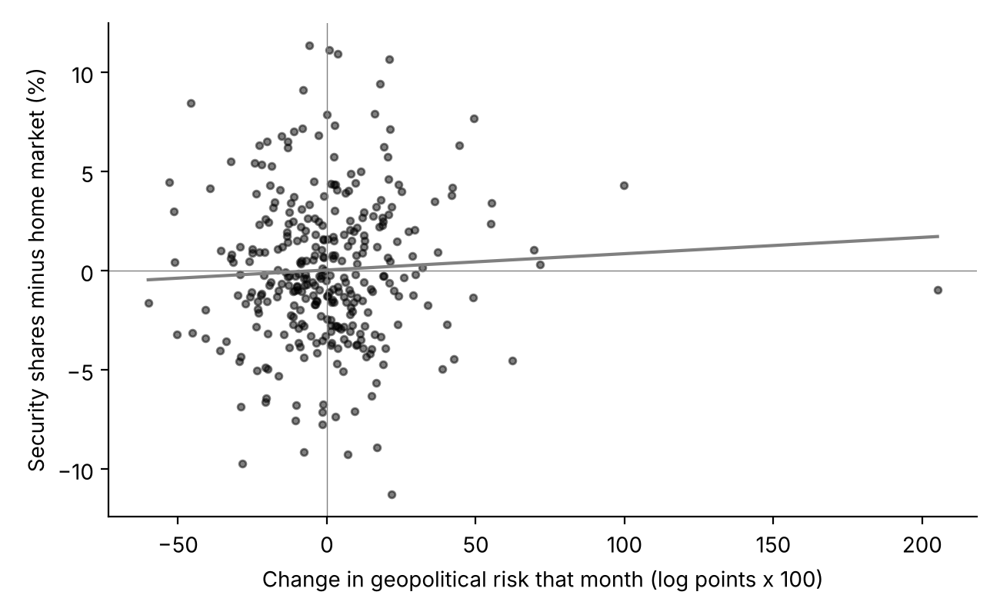
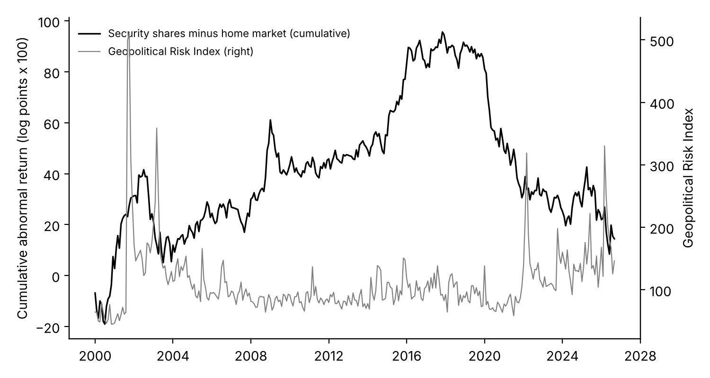

# security-stocks-risk

Do the shares of private security companies move with geopolitical risk?

## What this project does

When world tension rises, investors might expect more demand for guarding, alarm monitoring and cash transport, and bid up the shares of the companies that sell them. Or they might treat these companies as ordinary service businesses. This project tests which is true for six listed guarding and cash-handling companies, from January 2000 to September 2026:

| Company | Home market | Compared with |
|---|---|---|
| SECOM | Tokyo | Nikkei 225 |
| Sohgo Security Services (ALSOK) | Tokyo | Nikkei 225 |
| Securitas | Stockholm | OMX Stockholm 30 |
| Loomis | Stockholm | OMX Stockholm 30 |
| Prosegur | Madrid | IBEX 35 |
| Brink's | New York | S&P 500 |

Geopolitical risk is measured by the Geopolitical Risk Index of Caldara and Iacoviello, built from the share of articles in major newspapers that discuss wars, terrorism and military tensions.

For each company and month, the project takes the share's return minus its home market's return (the **abnormal return**), so that ordinary market swings drop out. It then tests whether the abnormal return is higher in months when geopolitical risk rises. Defence contractors are left out on purpose: they sell to militaries, which is a different business.

The tests were written down in [`analysis_plan.md`](analysis_plan.md) before any price data were downloaded. Every later change is listed there with its date and reason.

## What it finds

**No clear relationship.** Across the six companies, a rise in geopolitical risk goes with a slightly better month for security shares, but the effect is small and could easily be chance.

- **All six together:** a rise in the risk index of one standard deviation (about 24 log points in a month) goes with security shares doing about 0.2 percentage points better than their home market. The 95 percent confidence interval runs from below zero to above zero (p = 0.33).
- **The 10 months with the biggest jumps in risk since 2000** (for example September 2001, February 2022 and October 2023): security shares beat their home market by 1.9 percentage points on average, against almost zero in an ordinary month. With only 10 months this is not statistically clear (p = 0.15).
- **Company by company:** SECOM (p = 0.03) and Securitas (p = 0.049) show a positive link on their own; the other four do not, and Brink's points the other way. With six companies tested, one or two results this strong are expected by chance alone.
- **Checks fixed in advance** (threats and acts separately, a market-model version, starting in 2005, Japanese and non-Japanese companies separately) all give the same picture: positive but small, none statistically clear.





These are relationships over time, not proof of cause: a tense month is usually also a month of other news. Full results are in [`output/tables/`](output/tables/).

## What is here

| Folder or file | Contents |
|---|---|
| `analysis_plan.md` | The tests, written before the data were downloaded, with every later change dated |
| `code/` | Numbered scripts, run in order |
| `data/raw/data_gpr_export.xls` | The Geopolitical Risk Index file used here (CC BY) |
| `data/README.md` | Sources, download dates, licences and variable definitions |
| `output/tables/` | All test results |
| `figures/` | The two charts above |

Share prices are **not** included, because Yahoo Finance does not allow its data to be republished. `code/01_download.py` downloads them.

## Results files

| File | Contents |
|---|---|
| `output/tables/regressions.csv` | Every regression: the portfolio test, the checks, and each company (coefficient on the monthly change in log GPR, Newey-West standard error with 3 lags, p-value, 95 percent interval) |
| `output/tables/top10_gpr_months.csv` | The 10 months with the largest rise in the index, with the portfolio's abnormal return in each |
| `output/tables/top10_test.csv` | The average abnormal return in those 10 months and its test |
| `output/tables/summary_by_company.csv` | Months covered and average abnormal return per company |

## How to reproduce the results

Needs Python 3.13 and the package versions pinned in `requirements.txt`.

```
pip install -r requirements.txt
python code/01_download.py       # risk index and share prices
python code/02_build_panel.py    # monthly abnormal returns, data/clean/panel.csv
python code/03_analysis.py       # tables and figures
```

The results above use data downloaded on October 29, 2026. The risk index's latest months are preliminary and Yahoo Finance revises prices occasionally, so a later download can differ slightly.

## Licences

Code: MIT (see [`LICENSE`](LICENSE)). The Geopolitical Risk Index keeps its own licence, Creative Commons BY, credited in `data/README.md`. Share prices come from Yahoo Finance and are not redistributed here.

## Cite

Azom, Kazi Affnann (2026). *security-stocks-risk: Do security company shares move with geopolitical risk?* GitHub. https://github.com/Affnann/security-stocks-risk

See also [`CITATION.cff`](CITATION.cff).
